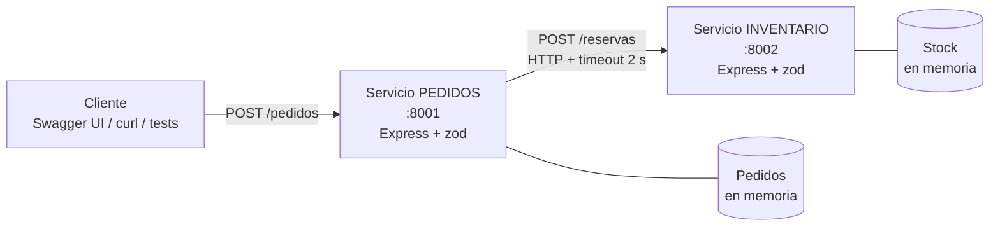

# Arquitectura del laboratorio

Pedidos es el servicio que consume y Inventario el que provee. Son procesos independientes que solo se comunican por HTTP/JSON (integración síncrona): Pedidos espera la respuesta de Inventario antes de contestarle al cliente.

**Punto de integración crítico:** `services/pedidos/src/inventarioClient.js` (llamada HTTP con timeout de 2 s y traducción de fallas de red).

## Qué responde Pedidos según lo que pase

| Situación | Respuesta de Inventario | Respuesta de Pedidos |
|---|---|---|
| Todo bien | 200 | 201 |
| Cantidad inválida | no se le llama | 400 `VALIDACION` |
| Producto inexistente | 404 | 404 `PRODUCTO_NO_EXISTE` |
| Stock insuficiente | 409 | 409 `STOCK_INSUFICIENTE` |
| Inventario responde 500 | 500 | 502 `INVENTARIO_RESPUESTA_INESPERADA` |
| Inventario apagado | conexión rechazada | 503 `INVENTARIO_NO_DISPONIBLE` |
| Inventario lento (> 2 s) | responde tarde | 504 `INVENTARIO_TIMEOUT` |

## Estructura del código por servicio

| Archivo | Responsabilidad |
|---|---|
| `server.js` | Arranque, puerto y apagado ordenado |
| `config.js` | Lee y valida variables de entorno con zod |
| `app.js` | Construye la app Express (middlewares, rutas, Swagger) |
| `schemas.js` | Validadores de entrada con zod |
| `errors.js` | `HttpError`, middleware de validación y manejador de errores con formato único |
| `store.js` | Datos en memoria |
| `openapi.js` | Especificación OpenAPI que alimenta Swagger UI |
| `inventarioClient.js` (Pedidos) | Cliente HTTP hacia Inventario |
| `pedidos.service.js` (Pedidos) | Regla de negocio: reservar y luego guardar |

Los dos servicios comparten a propósito `errors.js` y `logger.js` copiados, no importados: en microservicios cada servicio es desplegable por separado y no debe depender del código del otro.

El identificador `x-request-id` se genera en Pedidos y se envía a Inventario, así una misma petición se puede rastrear en los logs de ambos.

Formato único de error: `{ "error": { "code": "...", "message": "...", "details": ... } }`.
